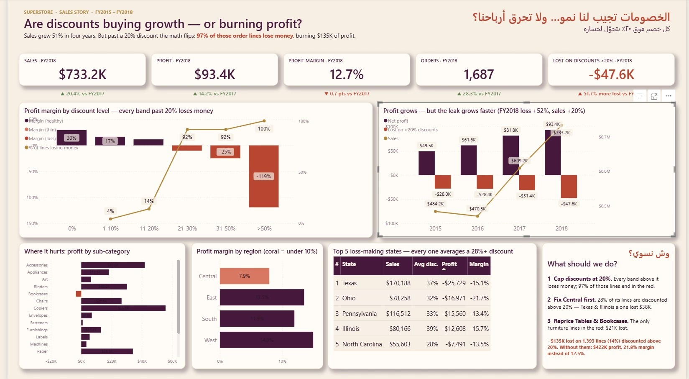

<h1 align="center">Discount Impact Analysis</h1>

<p align="center">
  A one-page Power BI data story that asks whether Superstore discounts bring growth or burn profit (2015–2018).
</p>

<p align="center">
  
  
  
  
</p>

<p align="center">
  
</p>

A short walkthrough video is available in [`assets/Discount_Profit_Analysis.mp4`](assets/Discount_Profit_Analysis.mp4).

## The question

Sales grew 51% between 2015 and 2018 — but is part of that growth paid for with discounts that lose money? The report follows profit margin across discount levels to find the point where discounts stop paying off.

## Dataset

`data/Superstore_Clean.xlsx` — the Superstore sample dataset after cleaning: 9,994 order lines, 26 columns, with a data quality sheet (0 blank cells, 0 duplicates, 0 invalid values). Added columns include `discount_band`, `days_to_ship`, `is_returned` and `region_manager`. A `Date` table supports the year-over-year measures.

## Report

One 1920×1080 page, **Discount Cliff**:

- Five KPI cards for 2018 compared with 2017: sales, profit, margin, orders and the loss from discounts above 20%
- Profit margin by discount band (losses in terracotta) with the share of order lines losing money
- Yearly profit vs. the loss from deep discounts
- Profit by sub-category, margin by region and the five states with the biggest losses
- A "what should we do?" box with the recommendation

## Key findings

| Discount band | Profit margin |
| --- | ---: |
| 0% | 29.5% |
| 1–10% | 16.6% |
| 11–20% | 11.6% |
| 21–30% | −10.0% |
| 31–50% | −24.8% |
| Over 50% | −119.2% |

- Margin turns negative as soon as the discount goes above 20% — this is the "cliff".
- Discounts above 20% cover 14% of order lines, and 97% of those lines lose money; together they lose $135,376.
- In 2018 the loss from deep discounts was $47.6K, up 51.7% from 2017, while total profit grew 14.2% to $93.4K and margin fell 0.7 points to 12.7%.

| 2018 KPI | Value | vs. 2017 |
| --- | ---: | ---: |
| Sales | $733.2K | ▲ 20.4% |
| Profit | $93.4K | ▲ 14.2% |
| Margin | 12.7% | ▼ 0.7 pts |
| Orders | 1,687 | ▲ 28.3% |
| Loss from discounts over 20% | −$47.6K | ▲ 51.7% |

## Key measures

The semantic model contains 59 DAX measures in display folders (Story, KPI cards, KPIs, Time Intelligence, Top 5 loss states, Returns &amp; Shipping); the full list is in [`dax/DAX-measures.dax`](dax/DAX-measures.dax).

```dax
Deep Discount Profit =
    CALCULATE ( [Total Profit], Orders[discount] > 0.2 )

Margin YoY pts =
    IF ( NOT ISBLANK ( [Margin LY] ), ( [Profit Margin %] - [Margin LY] ) * 100 )
```

## Tools

- **Power BI Desktop** — report, semantic model and custom theme (`Aubergine Terracotta`)
- **DAX** — measures, time intelligence, conditional colours and rankings
- **Power Query (M)** — loading the clean workbook through a `FilePath` parameter
- **Excel** — data cleaning and quality checks

## Project structure

```
Discount-Impact-Analysis/
├── dashboard/
│   ├── Superstore_Discount_Story.pbip              # open this in Power BI Desktop
│   ├── Superstore_Discount_Story.Report/           # report page and visuals
│   ├── Superstore_Discount_Story.SemanticModel/    # data model, Power Query, DAX
│   └── Aubergine_Terracotta_Theme.json             # Power BI theme
├── dax/
│   └── DAX-measures.dax
├── data/
│   └── Superstore_Clean.xlsx
├── screenshots/
├── assets/
│   └── Discount_Profit_Analysis.mp4
├── README.md
└── README_AR.md
```

## How to open

1. Clone the repository or download it as a ZIP and extract it (do not open files from inside the ZIP).
2. Open `dashboard/Superstore_Discount_Story.pbip` in a recent version of Power BI Desktop.
3. Click **Home → Refresh**. The data is embedded in the model, so the report works without moving any file.
4. To read from the workbook directly, set **Transform data → Edit parameters → FilePath** to the full path of `data/Superstore_Clean.xlsx`, then refresh.

If Power BI shows a privacy-levels prompt, set **File → Options and settings → Options → Privacy → Ignore the Privacy Levels** and refresh again. To keep a single file, use **File → Save as → Power BI file (.pbix)**.

## نبذة بالعربي

قصة بيانات من صفحة وحدة بسؤال: «الخصومات تجيب لنا نمو… ولا تحرق أرباحنا؟» — تتبّع هامش الربح حسب نسبة الخصم في بيانات Superstore (2015–2018) وتبيّن إن أي خصم فوق 20% يقلب الربح خسارة. التفاصيل الكاملة في [README_AR.md](README_AR.md).

---

<p align="center"><b>Author:</b> Fay Naif · <a href="https://github.com/fay-naif">GitHub</a> · <a href="https://www.linkedin.com/in/fay-naif-4295663b7">LinkedIn</a></p>
