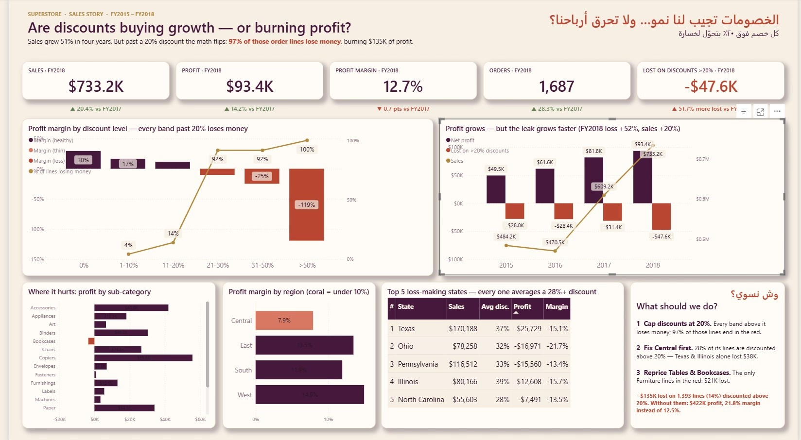

# تحليل أثر الخصومات

قصة بيانات في Power BI بسؤال واحد: **«الخصومات تجيب لنا نمو… ولا تحرق أرباحنا؟»** — على بيانات متجر Superstore (2015–2018).

  

## السؤال

المبيعات نمت 51% من 2015 إلى 2018، بس هل جزء من هالنمو جاي من خصومات خسرانة؟ التقرير يتتبّع هامش الربح حسب نسبة الخصم ويحدد النقطة اللي يصير فيها الخصم خسارة.

## البيانات

`data/Superstore_Clean.xlsx` — بيانات Superstore بعد التنظيف: 9,994 سطر و26 عمود، مع ورقة فحص جودة (0 خلايا فارغة، 0 تكرار، 0 قيم غير صالحة).

## تنظيف وتجهيز البيانات

تنظيف البيانات وفحصها وتجهيزها: **في نايف**. البيانات من عينة Superstore العامة (المصدر مذكور في ورقة `Data Quality`)، وتم الاحتفاظ بكل السجلات والأعمدة بدون حذف أو تعويض قيم.

**فحوصات الجودة** (النتائج كاملة في ورقة `Data Quality`): 9,994 سجل و26 عمود · 0 خلايا فارغة · 0 تكرار · 0 أرقام أو تواريخ غير صالحة · 0 تاريخ شحن قبل تاريخ الطلب · 0 مسافات زائدة · 1,871 سطر ربحه سالب (تم الاحتفاظ بها لأنها بيانات صحيحة).

**الأعمدة المضافة:** `order_year`، `order_month`، `days_to_ship`، `discount_band`، `is_returned`، `region_manager`.

**خطوات Power Query** (الكود كامل في [`power-query/queries.pq`](power-query/queries.pq)): تحميل الملف عبر باراميتر `FilePath` ← اختيار الأعمدة ← ضبط أنواع البيانات ← إضافة عمود ترتيب شرائح الخصم. وجدول `Date` بلغة DAX مبني من تواريخ الطلبات.

## الصفحة

صفحة وحدة 1920×1080 «Discount Cliff»: خمس بطاقات لسنة 2018 مع المقارنة بـ2017، هامش الربح حسب نسبة الخصم (التيراكوتا = خسارة) مع نسبة الطلبات الخسرانة، الربح السنوي مقابل خسارة الخصومات فوق 20%، الربح حسب الفئة الفرعية، الهامش حسب المنطقة، أكثر 5 ولايات خسارة، وصندوق «وش نسوي؟».

## أهم النتائج

| نسبة الخصم | هامش الربح |
| --- | ---: |
| 0% | 29.5% |
| 1–10% | 16.6% |
| 11–20% | 11.6% |
| 21–30% | −10.0% |
| 31–50% | −24.8% |
| فوق 50% | −119.2% |

- الهامش يصير سالب أول ما يتعدى الخصم 20%.
- الخصومات فوق 20% تمثل 14% من الأسطر، و97% منها خسرانة، ومجموع خسارتها 135,376$.
- في 2018 خسارة الخصومات فوق 20% وصلت 47.6K$ (▲ 51.7% عن 2017)، والربح 93.4K$ (▲ 14.2%)، والهامش 12.7% (▼ 0.7 نقطة).

## طريقة الفتح

1. نزّلي المستودع كـ ZIP وفكّي الضغط.
2. افتحي `dashboard/Superstore_Discount_Story.pbip` في Power BI Desktop.
3. اضغطي **Home → Refresh**.
4. لو طلعت رسالة الخصوصية: File → Options and settings → Options → Privacy → Ignore the Privacy Levels ثم Refresh.

## الأدوات

Power BI Desktop · DAX · Power Query · Excel

---

**إعداد:** في نايف · [GitHub](https://github.com/fay-naif) · [LinkedIn](https://www.linkedin.com/in/fay-naif-4295663b7)

